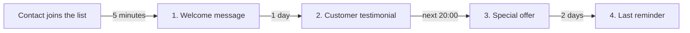

**Smart Campaign** is Wajom's next-generation campaign for sending automatic follow-up messages to every contact in a list. You arrange a few **steps** (for example a welcome message, a testimonial, an offer and a reminder), choose when each step is sent, and Wajom sends them to each contact on that contact's own timeline.

Smart Campaign replaces the old Evergreen Campaign and Loop Message in one place, with these advantages:

- Every delivery is recorded in the **Delivery trace**, so you know which messages were sent, delivered, read or failed.
- New contacts that join the list are enrolled automatically while the campaign is active.
- One list can have more than one Smart Campaign.

The example in this guide is a **New Customer Follow-up** campaign with 4 steps:

## Prerequisites

> **Tip**: Your WhatsApp number is connected and online in the Wajom portal ([portal.wajom.co](https://portal.wajom.co)).

> **Tip**: You already have a contact list. An empty list is fine, contacts can be added later.

---

## 1. Opening Smart Campaign

1. Open your WhatsApp instance in the Wajom portal, then choose the contact list you want to follow up.
2. On that list's contacts page, click the **✨** icon button (the green sparkle icon in the row of buttons above the contact list). Hover over it and you will see the **Smart Campaign** label.
3. If the list has no campaign yet, you will see a short guide, **Your first message starts here**. Click **Add step** to begin:

> **Tip**: A new campaign starts as a **Draft**. Nothing is sent until the campaign is activated, so you can build all the steps calmly.

---

## 2. Writing the First Step

Each step is one "send point" in a contact's journey. After clicking **Add step**, a new step card opens:

1. Write your message in the editor. Use the toolbar for **bold**, *italic*, lists or quotes, just like WhatsApp formatting.
2. Click **+** below the editor to attach a file (image, video, PDF and so on) if needed.
3. Click **Add message** if one step should send more than one message (up to 10 messages per step). Messages in the same step are sent one after another a few seconds apart.
4. Check the **Preview** box to see how the message looks in WhatsApp.
5. Click **Save step**.

---

## 3. Setting the Send Time

The **When it sends** section decides when this step goes out. For the first step, the timer starts when the contact is enrolled in the campaign. For every later step, it starts after the previous step has finished.

There are 3 options:

| Option | What it does | Example |
|---|---|---|
| **Delay** | Wait a set time (minutes, hours, days or weeks) after the previous step. | Send a welcome message 5 minutes after the contact joins the list. |
| **Fixed time** | Send at the next time slot: hourly, daily, weekly or monthly. | Send the offer at 20:00 the next evening. |
| **Exact date** | Send on one chosen date and time. | A sale announcement on 11 November at 9:00 am. |

Example of **Fixed time** with a **Daily** pattern at **20:00**:

> **Tip**: Read the short sentence under the time options (for example *"Sends once, 5 minutes after the previous step finishes"*). It explains exactly when the message will go out.

---

## 4. Using Contact Names and Message Variations

Below the editor are two tools that make messages personal and different between contacts:

- **+name** inserts `[name]`, which is replaced by the contact's name when sent. **+phone** inserts `[phone]` for the contact's phone number.
- **{A|B}** inserts sentence variations (*spintax*). For example `{Hi|Hello|Hey} [name]!` sends one of "Hi", "Hello" or "Hey" at random to each contact.

> **Tip**: Variations keep your messages from looking exactly the same for every recipient. Click the refresh icon in the **Preview** box to see another variation.

---

## 5. Arranging All the Steps

Repeat sections 2 to 4 for every follow-up message. The campaign shows as a timeline, and every step shows when it is sent (for example **WAIT 1 DAY** or **DAILY 20:00**):

- Drag the dotted handle to the left of a step title to change the order.
- Use the switch on each step to turn a step off without deleting it.
- Click a step title to open it again and edit its content.
- One campaign can have up to 50 steps.

---

## 6. Campaign Settings

Click the **Settings** icon (the sliders icon at the right end of the campaign's top row) to open the settings:

- **Campaign name**: a name for your own reference.
- **How it runs**:
  - **Single pass**: each contact goes through every step exactly once, then finishes. Good for following up new customers.
  - **Loop forever**: after the last step, the contact starts again from Step 1. Good for repeating reminders (for example a message every Monday). **Exact date** cannot be used in this mode.
- **Delivery timezone**: the timezone used for **Fixed time** steps. For Malaysia, choose **UTC+8 — Kuala Lumpur, Singapore**, or click **Use mine** to follow your device's timezone.
- **Lateness tolerance (minutes)**: a schedule missed by less than this is still sent normally.
- **Max messages per minute**: the send cap for this campaign in every 60 seconds.
- **Delay between contacts (sec)**: spacing between one contact and the next, so messages do not all go out at once.
- **When a schedule is missed** (for example WhatsApp disconnects for 2 hours):
  - **Skip it**: missed messages are never sent.
  - **Send catch-up**: messages are sent late, limited by **Max catch-ups per contact** so a contact is not flooded.
  - **Reschedule**: messages roll into the next slot.

Click **Save settings** after making changes.

> **Tip**: A low **Max messages per minute** and a few seconds of **Delay between contacts** are safer for your WhatsApp number, especially with large lists.

---

## 7. Activating the Campaign

When all the steps are ready, turn on the **Draft** switch at the top of the campaign until it shows **Active**:

While the campaign is **Active**:

- Every contact in the list is enrolled automatically, and each contact starts receiving Step 1 at its set send time.
- New contacts added to the list later (by CSV import, forms, Agent AI and so on) are also enrolled automatically and start from Step 1.

Click **Enroll current contacts** to enroll the contacts that are in the list right now immediately. A confirmation window shows the number of contacts, the number of steps and the missed-schedule setting:

> **Tip**: To pause, turn the **Active** switch off again. Pending deliveries are held and continue when the campaign is activated again.

---

## 8. Checking the Delivery Trace

Click the **Trace** button at the top of the campaign to open the **Delivery trace**. It lists every message the campaign has scheduled and sent:

- The cards at the top count deliveries by status: **Sent**, **Pending**, **Sending**, **Held**, **Uncertain**, **Skipped**, **Cancelled** and **Failed**.
- Filter the list by **Status** or **Step**, or search for a specific **Contact** number.
- Choose **Current run** for deliveries since the campaign was last started, or **All history** for every record.
- The status column also shows the WhatsApp status, such as **Delivered to device** and **Read**.

Click any row to see the delivery detail, including the actual message the contact received (with the contact's name filled in):

---

## 9. More Than One Campaign, Restart, Export and Import

- **New campaign**: one list can have several Smart Campaigns (for example one for new-customer follow-up and one for a year-end promo). Click **New campaign**, give it a name, then click **Create**.
- **Restart SC**: every contact in the list starts again from the first step. Deliveries still pending are cancelled, and the old history stays in the Delivery trace.
- **Export all** / download icon: save campaigns as a file for backup or to reuse in another list.
- **Import to list** / upload icon: import a Smart Campaign file as a new campaign. You can also import an **old Evergreen Campaign** or **old Loop Message**, so you do not have to rewrite your messages.

> **Tip**: Imported campaigns start as a Draft. Review the steps and settings before activating.

---

## FAQ

**Why has a message not been sent even though the step is ready?**
Make sure the campaign is **Active**, the WhatsApp number is online, and the step is switched on. Also check the **Delivery trace**: a **Pending** delivery shows when it is scheduled.

**Will a contact receive the same message twice?**
In **Single pass** mode, each contact receives each step only once. Messages repeat only in **Loop forever** mode or after you click **Restart SC**.

**What happens if WhatsApp disconnects?**
It depends on the **When a schedule is missed** setting: messages are skipped, sent late (with a per-contact limit) or rescheduled to the next slot.
