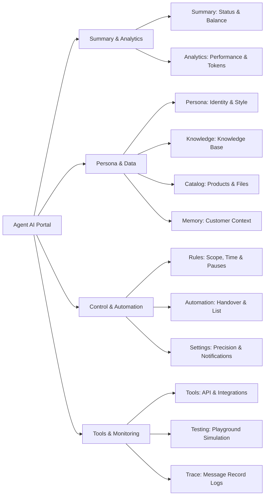

Agent AI is Wajom's next-generation smart virtual assistant designed specifically to handle business WhatsApp conversations autonomously. Agent AI does not merely answer questions based on a knowledge base; it can also remember customer records, trigger business automations, execute external data integrations, and provide full transparency through a trace tracking system.

## Key Features of Agent AI

---

## Understanding the Agent AI Interface

When you open the WhatsApp instance menu in the Wajom portal and select the **Agent AI** tab, you will find the following main navigation structure:

### Agent AI Menu Tab Navigation

| Tab | Main Function |
| --- | --- |
| **Summary** | Monitor the bot's active/inactive status, remaining AI token balance, getting started guide, and activity metrics for the last 24 hours. |
| **Analytics** | Analyze total messages handled, successful vs. failed reply ratios, daily token usage trends, and cache hit ratios. |
| **Persona** | Define the business name, company name, behavioral instructions (_prompt_), reply language, human-like speaking style, and welcome messages. |
| **Knowledge** | Manage knowledge documents, FAQ information, store policies, and pricing guides referenced by the AI when crafting replies. |
| **Catalog** | Store CRM product lists (prices, stock, photos) and attachment documents (PDF brochures, price sheets) that the bot can send. |
| **Memory** | View summaries of unique facts about each customer gathered from previous chats, and manage reset/forget memory options per customer. |
| **Rules** | Set message scope (individual/group), trigger mode (_all messages_ vs. _keyword_), operational hours, and pause control keywords. |
| **Automation** | Configure admin _handover_ escalations, automatic labeling, contact saving (_Add to list_), and follow-up messages. |
| **Tools** | Connect _Custom Actions_ (API webhooks) and third-party data connectors (_Google Sheets_ and _Web Extractor_). |
| **Testing** | A simulation area (_Playground_) to test conversation scenarios with Agent AI without sending messages to actual WhatsApp chats. |
| **Trace** | Live inspection logs for every incoming message: processing status, response time, reasons if skipped, and token usage per conversation. |
| **Settings** | Adjust AI precision level (_temperature_), long message splitting, image/audio media processing, and admin WhatsApp notifications. |

---

## Activation Status and Token Balance

At the top of the Summary card, you can view the two most critical operational components:

1.  **Agent AI Status Toggle Switch**: Determines whether the automated assistant is actively replying to incoming customer messages or is turned off.
2.  > **Tip**: 
    
3.  A single WhatsApp number in Wajom can only run either **AI Chat** or **Agent AI**. Both cannot be active simultaneously on the same number.

1.  **AI Token Balance**: Displays the remaining token quota available for your account. Every message processed and replied to by the AI deducts from this token balance based on your selected precision level.

---

## 4 Steps to Get Started with Agent AI

To set up your Agent AI from scratch until it is ready for operation, follow these sequential steps:

### Set Up Persona

Enter your business name and define your agent's role and tone of voice in the [Persona](/agent-ai/cara-menetapkan-gaya-sembang) tab.

### Add Knowledge

Add FAQs, product details, or your service SOPs in the [Knowledge](/agent-ai/cara-menetapkan-knowledge) tab.

### Test in the Playground

Open the [Testing](/agent-ai/playground) tab to interact directly and verify that the agent's answers are accurate.

### Activate Agent AI

Turn on the main toggle switch in the [Summary](/agent-ai/cara-mengaktifkan) tab so that Agent AI starts serving your WhatsApp customers.

---

## Last 24 Hours Activity Summary

At the bottom of the Summary page, there is a concise performance report for Agent AI over the last 24 hours:

-   **Chats Replied**: The number of incoming customer messages successfully answered normally by Agent AI.
-   **Tokens Used**: The accumulated token quota consumed to process conversations today.
-   **Skipped**: The number of messages deliberately skipped (for example, outside operational hours, included in exclusion lists, or blocked by pause keyword rules).
-   **Failed / Fallback Replies**: Messages that failed to be processed by the AI or were redirected to a fallback message due to system errors.
-   **Average Reply Time**: The average response speed of Agent AI from the moment a message is received until the reply is sent to WhatsApp.
