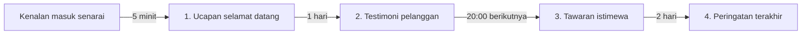

**Smart Campaign** ialah kempen generasi baharu Wajom untuk menghantar mesej susulan (*follow-up*) secara automatik kepada setiap kenalan dalam satu senarai. Anda susun beberapa **langkah** (contohnya ucapan selamat datang, testimoni, tawaran dan peringatan), tetapkan bila setiap langkah dihantar, dan Wajom akan menghantarnya kepada setiap kenalan mengikut jadual mereka sendiri.

Smart Campaign menggantikan Evergreen Campaign dan Loop Message lama dalam satu tempat, dengan kelebihan berikut:

- Setiap penghantaran direkodkan di **Jejak penghantaran**, jadi anda tahu mesej mana yang sudah dihantar, sampai, dibaca atau gagal.
- Kenalan baharu yang masuk ke senarai akan didaftarkan secara automatik semasa kempen aktif.
- Satu senarai boleh ada lebih daripada satu Smart Campaign.

Contoh dalam panduan ini ialah kempen **Follow-up Pelanggan Baru** dengan 4 langkah:

## Prasyarat

> **Tip**: Nombor WhatsApp anda sudah disambungkan dan berstatus online di portal Wajom ([portal.wajom.co](https://portal.wajom.co)).

> **Tip**: Anda sudah ada senarai (*list*) kenalan. Senarai kosong pun boleh, kenalan boleh ditambah kemudian.

---

## 1. Membuka Smart Campaign

1. Buka instance WhatsApp anda di portal Wajom, kemudian pilih senarai kenalan yang mahu dihantar mesej susulan.
2. Di halaman kenalan senarai tersebut, klik butang ikon **✨** (ikon bintang berkilau berwarna hijau di deretan butang atas senarai kenalan). Halakan tetikus ke butang itu dan anda akan melihat label **Smart Campaign**.
3. Jika senarai ini belum ada kempen, anda akan melihat panduan ringkas **Mesej pertamamu bermula di sini**. Klik **Tambah langkah** untuk mula:

> **Tip**: Kempen baharu bermula sebagai **Draf**. Tiada mesej dihantar selagi kempen belum diaktifkan, jadi anda boleh menyusun semua langkah dengan tenang.

---

## 2. Menulis Langkah Pertama

Setiap langkah ialah satu "titik hantar" dalam perjalanan kenalan. Selepas klik **Tambah langkah**, kad langkah baharu akan terbuka:

1. Tulis mesej anda dalam editor. Gunakan bar alat untuk **tebal**, *condong*, senarai atau petikan, sama seperti format WhatsApp.
2. Klik **+** di bawah editor untuk melampirkan fail (gambar, video, PDF dan lain-lain) jika perlu.
3. Klik **Tambah mesej** jika satu langkah perlu menghantar lebih daripada satu mesej (maksimum 10 mesej setiap langkah). Mesej dalam langkah yang sama dihantar berturut-turut dengan jeda beberapa saat.
4. Semak kotak **Pratonton** untuk melihat rupa mesej di WhatsApp.
5. Klik **Simpan langkah**.

---

## 3. Menetapkan Waktu Hantar

Bahagian **Waktu hantar** menentukan bila langkah ini dihantar. Untuk langkah pertama, kiraan bermula sejak kenalan didaftarkan ke kempen. Untuk langkah seterusnya, kiraan bermula selepas langkah sebelumnya selesai.

Ada 3 pilihan:

| Pilihan | Fungsi | Contoh |
|---|---|---|
| **Jeda** | Tunggu tempoh tertentu (minit, jam, hari atau minggu) selepas langkah sebelumnya. | Hantar ucapan 5 minit selepas kenalan masuk senarai. |
| **Masa tetap** | Hantar pada slot masa berikutnya: setiap jam, harian, mingguan atau bulanan. | Hantar tawaran pada jam 20:00 malam berikutnya. |
| **Tarikh tepat** | Hantar pada satu tarikh dan masa yang dipilih. | Pengumuman jualan pada 11 November, jam 9:00 pagi. |

Contoh **Masa tetap** dengan pola **Harian** jam **20:00**:

> **Tip**: Baca ayat ringkas di bawah pilihan waktu (contohnya *"Dihantar sekali, 5 minit selepas langkah sebelumnya selesai"*). Ayat itu menerangkan dengan tepat bila mesej akan keluar.

---

## 4. Menggunakan Nama Kenalan dan Variasi Mesej

Di bawah editor ada dua alat untuk menjadikan mesej lebih peribadi dan tidak serupa antara kenalan:

- **+name** memasukkan `[name]`, yang akan ditukar kepada nama kenalan semasa dihantar. **+phone** memasukkan `[phone]` untuk nombor telefon kenalan.
- **{A|B}** memasukkan variasi ayat (*spintax*). Contohnya `{Hai|Hello|Salam} [name]!` akan menghantar salah satu daripada "Hai", "Hello" atau "Salam" secara rawak kepada setiap kenalan.

> **Tip**: Variasi mesej membantu supaya mesej anda tidak kelihatan sama sepenuhnya untuk setiap penerima. Klik ikon muat semula di kotak **Pratonton** untuk melihat variasi lain.

---

## 5. Menyusun Semua Langkah

Ulang langkah 2 hingga 4 untuk setiap mesej susulan. Kempen akan kelihatan seperti garis masa, dan setiap langkah menunjukkan bila ia dihantar (contohnya **TUNGGU 1 HARI** atau **HARIAN 20:00**):

- Seret ikon titik-titik di kiri tajuk langkah untuk menukar susunan.
- Gunakan suis pada setiap langkah untuk mematikan langkah tertentu tanpa memadamnya.
- Klik tajuk langkah untuk membuka semula dan mengedit kandungannya.
- Satu kempen boleh ada sehingga 50 langkah.

---

## 6. Tetapan Kempen

Klik ikon **Tetapan** (ikon gelangsar di hujung kanan baris atas kempen) untuk membuka tetapan:

- **Nama kempen**: nama untuk rujukan anda sendiri.
- **Cara ia berjalan**:
  - **Sekali lalu**: setiap kenalan melalui semua langkah tepat sekali, kemudian selesai. Sesuai untuk follow-up pelanggan baharu.
  - **Loop selamanya**: selepas langkah terakhir, kenalan bermula semula dari Langkah 1. Sesuai untuk peringatan berulang (contohnya mesej setiap Isnin). Pilihan **Tarikh tepat** tidak boleh digunakan dalam mod ini.
- **Zon waktu penghantaran**: zon waktu untuk langkah **Masa tetap**. Untuk Malaysia, pilih **UTC+8 — Kuala Lumpur, Singapura**, atau klik **Guna saya** untuk mengikut zon waktu peranti anda.
- **Toleransi kelewatan (minit)**: jadual yang terlewat kurang daripada nilai ini masih dihantar seperti biasa.
- **Maks mesej seminit**: had jumlah mesej kempen ini dalam setiap 60 saat.
- **Jeda antara kontak (saat)**: jarak masa antara satu kenalan dengan kenalan seterusnya, supaya mesej tidak keluar serentak.
- **Bila jadual terlepas** (contohnya WhatsApp terputus selama 2 jam):
  - **Langkau**: mesej yang terlepas tidak dihantar.
  - **Hantar susulan**: mesej dihantar lewat, terhad kepada **Maks susulan setiap kenalan** supaya kenalan tidak dibanjiri mesej.
  - **Jadual semula**: mesej dipindahkan ke slot berikutnya.

Klik **Simpan tetapan** selepas membuat perubahan.

> **Tip**: Nilai **Maks mesej seminit** yang rendah dan **Jeda antara kontak** beberapa saat lebih selamat untuk nombor WhatsApp anda, terutamanya untuk senarai yang besar.

---

## 7. Mengaktifkan Kempen

Apabila semua langkah sudah siap, hidupkan suis **Draf** di bahagian atas kempen sehingga bertukar menjadi **Aktif**:

Semasa kempen **Aktif**:

- Semua kenalan dalam senarai didaftarkan ke kempen secara automatik, dan setiap kenalan mula menerima Langkah 1 mengikut waktu hantar yang ditetapkan.
- Kenalan baharu yang ditambah ke senarai kemudian (melalui import CSV, borang, Agent AI dan lain-lain) juga didaftarkan secara automatik dan bermula dari Langkah 1.

Klik **Daftarkan kontak semasa** jika mahu mendaftarkan kenalan yang ada sekarang dengan segera. Tetingkap pengesahan akan menunjukkan jumlah kenalan, jumlah langkah dan tetapan jadual terlepas:

> **Tip**: Untuk berhenti seketika, matikan semula suis **Aktif**. Penghantaran yang tertunda akan ditahan dan diteruskan apabila kempen diaktifkan semula.

---

## 8. Menyemak Jejak Penghantaran

Klik butang **Jejak** di bahagian atas kempen untuk membuka **Jejak penghantaran**. Di sini anda boleh melihat setiap mesej yang dijadualkan dan dihantar oleh kempen:

- Kad di bahagian atas menunjukkan jumlah mengikut status: **Dihantar**, **Tertunda**, **Menghantar**, **Ditahan**, **Status belum pasti**, **Dilangkau**, **Dibatalkan** dan **Gagal**.
- Tapis senarai mengikut **Status**, **Langkah** atau cari nombor **Kontak** tertentu.
- Pilih **Run semasa** untuk penghantaran sejak kempen terakhir dimulakan, atau **Semua sejarah** untuk semua rekod.
- Lajur status juga menunjukkan status WhatsApp seperti **Sampai ke peranti** dan **Dibaca**.

Klik mana-mana baris untuk melihat butiran penghantaran, termasuk mesej sebenar yang diterima kenalan (dengan nama kenalan yang sudah diisi):

---

## 9. Lebih Daripada Satu Kempen, Restart, Eksport dan Import

- **Kempen baharu**: satu senarai boleh ada beberapa Smart Campaign (contohnya satu untuk follow-up pelanggan baharu dan satu lagi untuk promosi hujung tahun). Klik **Kempen baharu**, beri nama, kemudian klik **Cipta**.
- **Restart SC**: semua kenalan dalam senarai bermula semula dari langkah pertama. Penghantaran yang masih tertunda akan dibatalkan, dan sejarah lama kekal di Jejak penghantaran.
- **Eksport semua** / ikon muat turun: simpan kempen sebagai fail untuk dijadikan sandaran atau digunakan di senarai lain.
- **Import ke senarai** / ikon muat naik: import fail Smart Campaign sebagai kempen baharu. Anda juga boleh mengimport **Evergreen Campaign lama** atau **Loop Message lama** supaya tidak perlu menulis semula mesej anda.

> **Tip**: Kempen yang diimport bermula sebagai Draf. Semak langkah dan tetapannya dahulu sebelum mengaktifkan.

---

## Soalan Lazim

**Kenapa mesej belum dihantar walaupun langkah sudah siap?**
Pastikan kempen berstatus **Aktif**, nombor WhatsApp online, dan langkah tersebut dihidupkan. Semak juga **Jejak penghantaran**: penghantaran berstatus **Tertunda** menunjukkan masa ia dijadualkan.

**Adakah kenalan akan menerima mesej yang sama dua kali?**
Dalam mod **Sekali lalu**, setiap kenalan menerima setiap langkah sekali sahaja. Mesej hanya berulang dalam mod **Loop selamanya** atau selepas anda klik **Restart SC**.

**Apa yang berlaku jika WhatsApp terputus?**
Ia bergantung kepada tetapan **Bila jadual terlepas**: mesej dilangkau, dihantar lewat (dengan had setiap kenalan) atau dijadualkan semula ke slot berikutnya.
