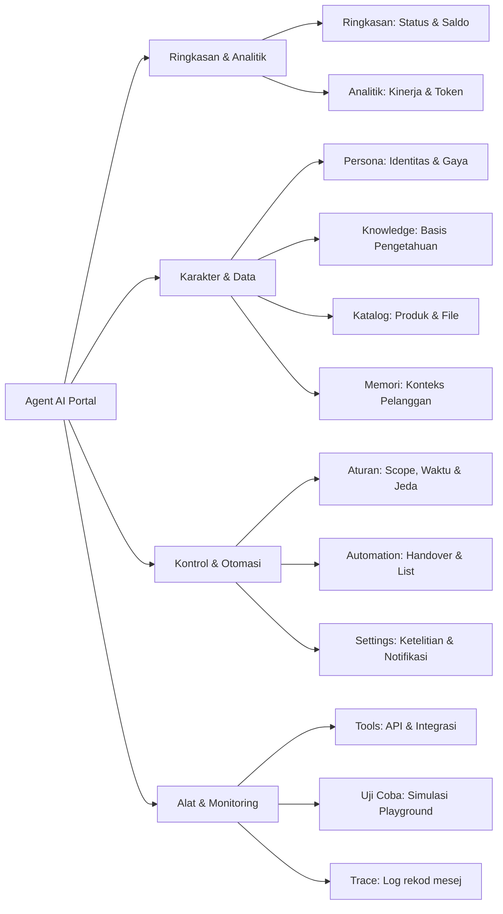

Agent AI adalah asisten virtual pintar generasi terbaru dari Wajom yang dirancang khusus untuk menangani percakapan WhatsApp bisnis secara mandiri. Agent AI tidak hanya menjawab pertanyaan berdasarkan basis pengetahuan (_knowledge base_), tetapi juga mampu mengingat rekod pelanggan, memicu otomasi bisnis, mengeksekusi integrasi data eksternal, dan memberikan transparansi penuh melalui sistem pelacakan (_trace_).

## ciri Utama Agent AI

---

## Memahami Antarmuka Agent AI

Saat anda membuka menu WhatsApp instance di portal Wajom dan memilih tab **Agent AI**, anda akan menemukan navigasi utama berikut:

### Navigasi Tab Menu Agent AI

| Tab | Fungsi Utama |
| --- | --- |
| **Ringkasan** | Memantau status aktif/nonaktif bot, sisa saldo token AI, panduan langkah awal, dan metrik aktivitas 24 jam terakhir. |
| **Analitik** | Menganalisis total mesej yang ditangani, rasio balasan berhasil vs gagal, tren penggunaan token harian, dan rasio cache. |
| **Persona** | Menentukan nama bisnis, nama perusahaan, instruksi perilaku (_prompt_), bahasa balasan, gaya bicara manusia, dan mesej sambutan. |
| **Knowledge** | Mengelola dokumen pengetahuan, informasi FAQ, kebijakan toko, dan panduan harga yang dibaca AI saat menyusun jawaban. |
| **Katalog** | Menyimpan daftar produk CRM (harga, stok, foto) dan dokumen lampiran (brosur PDF, panduan harga) yang dapat dikirim bot. |
| **Memori** | Melihat rangkuman fakta unik setiap pelanggan dari sembang lama dan mengelola opsi reset/lupa data memori per pelanggan. |
| **Aturan** | Menentukan cakupan mesej (_scope_ pribadi/kumpulan), mode pemicu (_all messages_ vs _keyword_), jam operasional, dan kata kunci kontrol jeda. |
| **Automation** | Mengonfigurasi eskalasi _handover_ admin, pemberian label otomatis, penyimpanan kontak (_Add to list_), dan mesej susulan (_follow-up_). |
| **Tools** | Menghubungkan _Aksi Khusus_ (API webhook) dan konektor data pihak ketiga (_Google Sheets_ serta _Web Extractor_). |
| **Uji coba** | Area simulasi (_Playground_) untuk mencoba skenario percakapan dengan Agent AI tanpa mengirimkan mesej ke WhatsApp sungguhan. |
| **Trace** | Log inspeksi langsung per mesej masuk: status pemrosesan, waktu respon, alasan jika dilangkau, dan pemakaian token per perbualan. |
| **Settings** | Menyesuaikan tingkat ketelitian AI (_temperature_), pemecahan mesej panjang, pembacaan media gambar/audio, dan notifikasi ke WA admin. |

---

## Status Aktivasi dan Saldo Token

Pada bagian atas kartu Ringkasan, anda dapat melihat dua komponen operasional terpenting:

1.  **Toggle Switch Status Agent AI**: Menentukan apakah asisten otomatis sedang aktif membalas mesej masuk pelanggan atau dalam keadaan nonaktif.
2.  > **Tip**: 
    
3.  Satu nombor WhatsApp di Wajom hanya boleh menjalankan salah satu antara **sembang AI** atau **Agent AI**. Keduanya tidak dapat diaktifkan secara bersamaan pada nombor yang sama.

1.  **Saldo Token AI**: Menampilkan sisa kuota token yang tersedia untuk akun anda. Setiap mesej yang diproses dan dibalas oleh AI akan memotong saldo token ini sesuai tingkat ketelitian yang anda pilih.

---

## 4 Langkah Memulai Agent AI

Untuk mempersiapkan Agent AI anda dari awal hingga siap beroperasi, ikuti urutan langkah berikut:

### Atur Persona

Masukkan nama bisnis dan jelaskan peran serta gaya bahasa ejen anda pada tab [Persona](/agent-ai/cara-menetapkan-gaya-sembang).

### Masukkan Pengetahuan

Tambahkan FAQ, detail produk, atau SOP layanan anda pada tab [Knowledge](/agent-ai/cara-menetapkan-knowledge).

### Uji Coba di Playground

Buka tab [Uji Coba](/agent-ai/playground) untuk berinteraksi langsung dan memastikan jawaban ejen sudah akurat.

### Aktifkan Agent AI

Nyalakan toggle switch utama pada tab [Ringkasan](/agent-ai/cara-mengaktifkan) agar Agent AI mulai melayani pelanggan WhatsApp anda.

---

## Ringkasan Aktivitas 24 Jam Terakhir

Pada bagian bawah halaman Ringkasan, terdapat laporan ringkas performa Agent AI selama 24 jam terakhir:

-   **sembang Dibalas**: Jumlah mesej masuk dari pelanggan yang berhasil dijawab secara normal oleh Agent AI.
-   **Token Terpakai**: Akumulasi kuota token yang dikonsumsi untuk memproses percakapan hari ini.
-   **dilangkau**: Jumlah mesej yang sengaja dilangkau (misalnya di luar jam operasional, masuk dalam daftar pengecualian, atau dicegah oleh aturan kata kunci jeda).
-   **Gagal / Jawaban Cadangan**: mesej yang gagal diproses oleh AI atau dialihkan ke mesej cadangan ketika terjadi gangguan sistem.
-   **Rata-rata Waktu Balas**: Kecepatan respon rata-rata Agent AI mulai dari mesej diterima hingga balasan terkirim ke WhatsApp.
